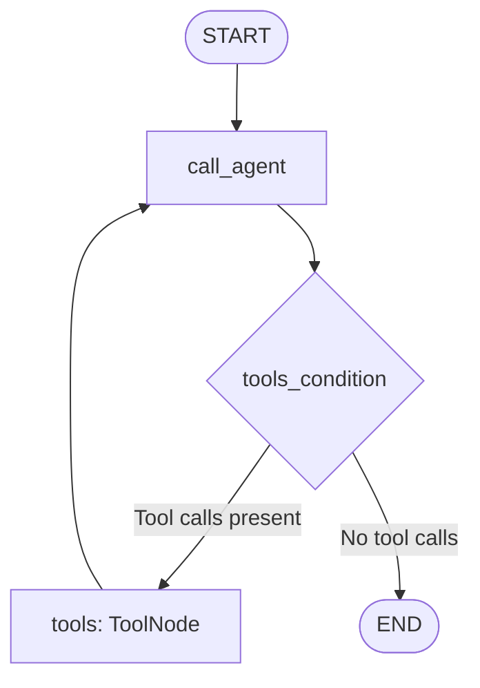

# ReAct Tool Calling — SmartCommerce AI

This educational lab answers customer questions about fictional orders, payments,
and deliveries using an LLM-driven tool-calling loop in LangGraph.

**Status: IN_PROGRESS.** The console uses a real Groq model with local synthetic
data. Offline tests script model responses; they do not measure real model quality.

## Learning goal

Understand how an agent requests a tool, receives its result, and decides whether
to request another tool or answer the customer. Unlike sequential chaining, the
number of LLM calls depends on the execution path.

A deterministic baseline could call the three lookup functions directly and format
a response. The LLM adds natural-language interpretation and tool selection, at
the cost of latency, inference cost, and variable decisions.

## Files

```text
03-react-tool-calling/
├── main.py               # Model, graph, prompt, and console rendering
├── tools.py              # Three read-only lookup tools
├── data.py               # Synthetic fixtures and lookup helper
├── README.md
└── tests/
    └── test_agent.py     # Offline tool, graph, and console tests
```

## Architecture and state



`MessagesState` stores the message history and uses its message reducer to merge
updates. Each node returns new messages rather than rebuilding the full history.

| Component | Responsibility |
| --- | --- |
| `call_agent` | Adds system instructions and invokes the tool-bound LLM |
| `tools_condition` | Routes to tools or END by inspecting the last message |
| `ToolNode` | Executes requested tools and returns `ToolMessage` results |
| `print_message` | Formats requests, lookup results, and the final answer |

The LLM selects tool names and arguments. Python executes the tools and controls
the graph edges. The instruction to check the order first is prompt guidance,
not a programmatically enforced dependency.

A typical history is:

```text
HumanMessage
AIMessage(tool_calls=[...])
ToolMessage(tool_call_id=...)
AIMessage(content="...", tool_calls=[])
```

The tool result's `tool_call_id` associates it with the original request. One AI
message can request several tools. Tool execution itself is not an LLM call.

## Tools and fixtures

| Tool | Input | Current successful result |
| --- | --- | --- |
| `get_order` | `order_id: str` | `order_id`, `customer`, `total_cents`, order `status` |
| `get_payment` | `order_id: str` | `payment_id`, `customer`, `total_cents`, payment `status` |
| `get_delivery` | `order_id: str` | `delivery_id`, `customer`, `total_cents`, `estimated_delivery`, delivery `status` |

All tools return `{"error": "Pedido não encontrado"}` for an unknown or
non-numeric order identifier. They only read local data; no payment is executed.
The current `payment_id` and `delivery_id` fields contain the order identifier,
not independent payment or shipment identifiers.

Order 1024 has statuses `confirmed`, `approved`, and `shipped`. Order 1025 has
statuses `pending_payment`, `pending`, and `pending`. Money is stored in integer
cents. Fixture dates are fixed examples, not current delivery promises.

## Run the live console

Use the repository's Python environment. The project proposes Python 3.12+;
the local verification environment for these tests uses Python 3.11.9.

Configure the following variables in the repository-root `.env` or your shell:

```dotenv
GROQ_API_KEY=your_groq_api_key
LLM_MODEL=your_tool_calling_model
```

Do not commit credentials. The selected model must support tool calling.
From the repository root:

```powershell
python 01-agent-orchestration/03-react-tool-calling/main.py
```

The prompt reads one line. For example:

```text
O pedido 1024 foi pago? Quando será entregue?
```

An illustrative status-only request may produce:

```text
SMARTCOMMERCE AI — REACT AGENT

Cliente:
Qual o status do pedido 1024?

[AGENT]
Solicitando get_order(order_id=1024)

[TOOL: get_order]
Pedido encontrado: confirmed

[AGENT - FINAL]
O pedido 1024 está confirmado.

[END]
```

The program also prints the configured model and an input prompt. Console labels
omit leading underscores from tool names. Wording, grouping, and order of model
requests can vary. The application uses `stream_mode="updates"` to avoid printing
the accumulated history repeatedly.

## Run offline tests

Install pytest if it is absent from your development environment:

```powershell
python -m pip install "pytest>=8,<9"
python -m pytest 01-agent-orchestration/03-react-tool-calling/tests -q -rx
```

No Groq key or `.env` is needed for the tests. The suite replaces `ChatGroq` before
importing `main.py`, disables dotenv loading, and blocks outbound socket connections.
It runs the actual graph, tools, and renderer with scripted AI messages. Local
modules are loaded by path to avoid collisions with other labs' `main.py` files.

Coverage includes:

- Correct order, payment, and delivery statuses for both fixtures.
- Unknown orders and invalid identifiers.
- Order lookup followed by payment and delivery calls, including call/result IDs.
- Direct final responses and lookup errors returned to the model.
- Repeated tool calls stopped by an explicitly configured graph recursion limit.
- Console formatting, tool errors, and unexpected payloads.

The fixture date consistency test is marked `xfail(strict=True)` because order
1025 does not use DD/MM/YYYY. `XFAIL` documents an unresolved gap.
After implementing a fix, the test becomes `XPASS(strict)` and fails until its
marker is removed. Do not treat these expected failures as completed functionality.

Scripted model responses validate software behavior, not real model selection,
grounding, prompt-injection resistance, or answer quality. These require separate
live evaluation cases.

Local offline verification on 2026-10-31: **23 passed, 1 xfailed**. The expected
failure is the inconsistent date in order 1025. No live Groq call was made during
this verification.

## Known limitations and next exercises within this lab

- Order 1025 uses `05/15/2026`, inconsistent with DD/MM/YYYY. Confirm the intended
  date before correcting it.
- `main.py` configures the model at import time. Tests isolate this with mocks;
  a future `build_graph(llm)` function would simplify dependency injection.
- The console does not explicitly configure or handle the graph recursion limit.
  The limit test supplies one; it does not add graceful error handling to the CLI.
- There is no offline CLI mode, persistence, or customer authorization layer.
- The installed environment differs from root `requirements.txt`: validation uses
  LangGraph 1.2.11, langchain-core 1.6.0, langchain-groq 1.1.3, Flask 3.0.3, and
  pytest 8.4.2. The root ranges constrain the first three to older versions.
  Reconcile the dependency versions before claiming reproducible installation;
  this lab's documentation and tests do not change those ranges.

## Debugger checklist

1. Inspect `state["messages"]` before and after `call_agent`.
2. Locate `tool_calls` on the first AI message.
3. Match each call ID with its `ToolMessage.tool_call_id`.
4. Confirm that the next model invocation receives the tool results.
5. Check that an AI message without tool calls ends the graph.
6. Try a missing order and explain which behavior is Python logic and which is
   a scripted or live model decision.

## References

- [LangGraph streaming](https://docs.langchain.com/oss/python/langgraph/streaming)
- [LangGraph recursion limits](https://docs.langchain.com/oss/python/langgraph/errors/GRAPH_RECURSION_LIMIT)
- [pytest monkeypatch](https://docs.pytest.org/en/stable/how-to/monkeypatch.html)
