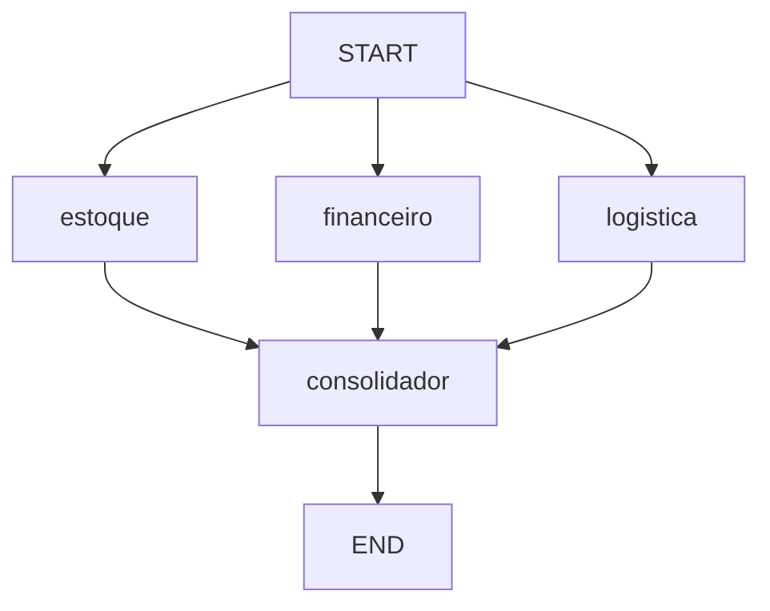

# Parallel order analysis

This lab demonstrates fixed fan-out/fan-in with a LangGraph `StateGraph`.
Stock, payment and delivery specialists analyze the same synthetic order in
parallel. One consolidator runs after all three specialists finish.
Each order uses four LLM calls: three specialist calls and one consolidation call.



`State.pedido` carries the input. Specialists return partial updates to
`avaliacoes`; its `operator.add` reducer combines the three lists without
overwriting concurrent results. A list of source nodes in `add_edge` makes
the consolidation barrier explicit. Completion order can vary.
With the current single-step branches, separate incoming edges would also
reach the consolidator in the next super-step.

The code confirms an order only when stock covers the requested quantity,
payment is approved and delivery is available. `status_pedido` stores that
decision; `parecer_final` contains the LLM explanation. Generated text may
still contradict the decision and must not be used as authorization.
No order is actually placed and no payment is processed.
A specialist failure aborts the run before consolidation; this lab does
not implement retry or recovery logic.

Run from the repository root with `LLM_MODEL` and `GROQ_API_KEY` configured:

```powershell
python 01-agent-orchestration/04-parallel-agents/main.py
```

The console analyzes orders 1024 (confirmed), 1025 (declined payment) and
1026 (insufficient stock and unavailable delivery), reusing one graph.

Run offline software tests without credentials or network:

```powershell
python -m pytest 01-agent-orchestration/04-parallel-agents/tests -q
```

Tests simulate model responses and check concurrency, merged state, a single
consolidation, deterministic decisions, failures and console execution.
They do not evaluate model quality. There is no mock CLI mode yet.
For these simple rules, deterministic functions alone are sufficient;
the LLM calls serve as an orchestration exercise and add latency and cost.
