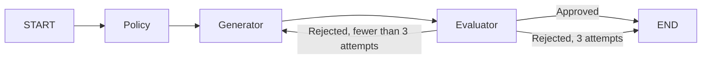

# Evaluator–Optimizer

Generate a customer support response, audit it, and revise it using feedback.
Python decides refund eligibility using fictional policies. The LLM drafts and
reviews wording; it cannot execute refunds or override eligibility.



The shared `RefundState` holds the request, order, policy result, draft, feedback,
attempt counter, and final response. Each revision receives the previous draft
and feedback, including missing requirements. The policy runs once per invocation.

`APPROVED` means the **text** passed review. A text explaining that human review
is required can pass without authorizing a refund. On exhaustion, the final status
is `REJECTED`, and no final response is published. A malformed evaluation counts
as rejection; provider failures propagate to the caller.

## Fictional rules

- Without a defect: up to 7 days after receipt.
- With a defect: up to 30 days after receipt.
- Eligible orders above 200,000 cents require human review.
- Missing or invalid receipt days, defect flag, or value produce `NEEDS_INFO`.

Amounts use integer `value_cents`. These rules do not represent Brazilian law.
Human review is only a policy outcome here; no human approval workflow is implemented.

## Run

From the repository root, using an environment with the repository dependencies:

```powershell
$env:LLM_MODEL = '<Groq model supporting tool calling>'
$env:GROQ_API_KEY = '<your key>'
venv/Scripts/python.exe 01-agent-orchestration/05-evaluator-optimizer/main.py
```

Configuration can also come from `.env`. Importing modules does not create a model
or call a provider. `build_graph(llm)` receives the model explicitly. Nodes call
the model directly; the evaluator uses `with_structured_output` with the local
Pydantic contract. No inner agent loop is needed.

The console uses `app.stream(..., stream_mode='updates')` to show each completed
node: policy result, draft and attempt number, evaluator verdict and feedback,
then retry or termination. Drafts are labeled as awaiting evaluation. The final
summary publishes a final response only when approved. This streams node updates,
not individual model tokens.

## Offline validation

```powershell
venv/Scripts/python.exe -m unittest discover -s 01-agent-orchestration/05-evaluator-optimizer/tests -v
```

Tests inject simulated responses and forbid network connections. They cover
approval, feedback retries, exhaustion, parsing errors, empty drafts, provider
failures, policy boundaries, configuration, and console output. They measure
software behavior, not real LLM quality. No separate mock CLI is provided.

Validation environment: Python 3.11.9, LangGraph 0.6.11, LangChain 0.3.30,
langchain-groq 0.3.8, Pydantic 2.14.3. The repository requirements declare newer
LangChain versions; those versions and live Groq behavior were not validated
in this review. The model must support structured output through tool calling.

An LLM auditor can make mistakes. The attempt bound limits the outer workflow
to three generation/evaluation pairs (at most six model invocations with no
provider retries); it does not guarantee response correctness. Policies are
deterministic, while auditing clarity and policy compliance remains probabilistic.

References: [LangGraph workflows](https://docs.langchain.com/oss/python/langgraph/workflows-agents)
and [structured output](https://docs.langchain.com/oss/python/langchain/structured-output).
