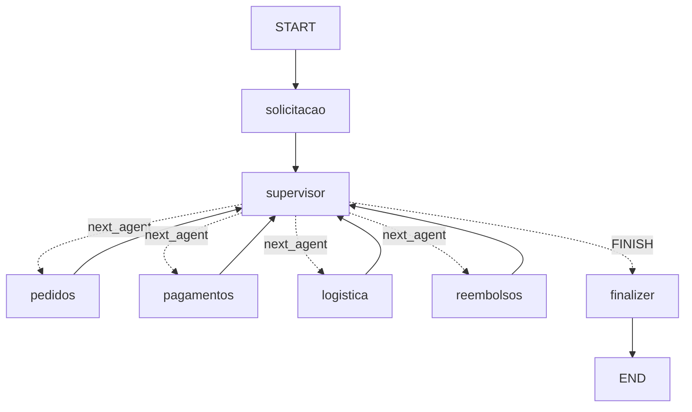

# LLM Supervisor

A customer reports that order 1024 was paid but has not arrived, and asks about
cancellation and a refund if delivery misses tomorrow's deadline.

The supervisor chooses one specialist at a time and revisits its decision after
each result. The graph defines available destinations, not an execution sequence.
This differs from Lab 02's single routing decision and Lab 04's parallel fan-out.

## Architecture



- `state.py`: shared State, append reducers, Pydantic decision contract and limits.
- `data.py`: synthetic order/payment/shipment fixtures and fictional refund policy v1.
- `agents.py`: supervisor prompt, specialist queries and final response.
- `graph.py`: conditional routing and edges returning control to the supervisor.
- `main.py`: Groq model creation and console streaming.
- `tests/test_supervisor.py`: offline software tests, not model quality evaluations.

Only the supervisor calls the LLM. The four specialists are deterministic
domain workers that query synthetic data. They do not need extra LLM calls for
these simple lookups. Refund rules and the final factual summaries run in Python.
No cancellation, payment or refund is executed.

## State and contract

Input: `request` and `order_id` (passed separately; no automatic ID extraction).

`SupervisorDecision(BaseModel)` requires:
- `next_agent`: pedidos, pagamentos, logistica, reembolsos or FINISH.
- `reason`: a nonempty, whitespace-trimmed explanation, up to 1,000 characters.

The supervisor uses `with_structured_output(..., method="function_calling",
include_raw=True)`. Pydantic validates the parsed decision before routing.
The prompt includes the request, order ID, all specialist results, previous
decisions and step count on every iteration.

`agent_results` stores agent, structured data and summary. `execution_history`
stores destination, reason and source (supervisor or guardrail). Both use
`operator.add`; nodes return only new items to avoid duplicating history.
`steps` counts specialist executions. `next_agent` and `decision_reason`
hold the latest routing decision. `final_status` and `final_response` hold
the outcome. State is in memory; there is no checkpoint or cross-process memory.

## Run

From the repository root, use the existing environment or install this lab's
tested direct dependency versions in a separate virtual environment:

```powershell
python -m pip install -r 01-agent-orchestration/06-llm-supervisor/requirements.txt
```

Configure `GROQ_API_KEY` and `LLM_MODEL` in the root `.env`
or environment. Use a Groq model with tool calling support.

```powershell
python 01-agent-orchestration/06-llm-supervisor/main.py
python 01-agent-orchestration/06-llm-supervisor/main.py --request "Qual o valor do pagamento?" --order-id 1024
python 01-agent-orchestration/06-llm-supervisor/main.py --order-id 9999
```

Execution always uses Groq and requires credentials. There is no alternate execution mode.
Console output shows the provider/model, each routing reason, specialist results,
final status and response. Streaming uses `app.stream(..., stream_mode="values")`
so accumulated lists reflect LangGraph reducers rather than plain dictionary
replacement.

## Deterministic boundaries

- At most eight specialist executions.
- At most two executions per specialist; the prompt requests a concrete new
  information need for repetition. Pydantic validates the explanation's form,
  not whether the justification is semantically valid.
- A third call to the same specialist ends with `AGENT_LIMIT`.
- After eight specialist executions, `STEP_LIMIT` ends execution without
  another LLM call. This takes precedence over any later FINISH.
- Invalid parsed output ends with `INVALID_DECISION`, without routing to a
  specialist. A rejected over-limit proposal remains in history.
- These controlled interruptions produce a manual-review message.
- Provider/transport failures propagate as technical errors, not success.
- `recursion_limit=21` is a secondary graph execution boundary.
- Groq timeout is 30 seconds per call, with retries disabled.

Normal FINISH yields `FINISHED`: it means the supervisor stopped, not that
the customer's issue has been resolved or that all required evidence was found.
The finalizer combines the latest factual summary per executed specialist.
It never publishes the model's reasoning as a customer-facing fact.

The fictional policy distinguishes a request for cancellation from approval.
An in-transit shipment whose ETA has not expired requires waiting until the
deadline; missed delivery or an already delivered item requires human review.
Amounts are integer cents. These rules do not represent Brazilian law.

## Validation evidence

Validated on 2026-11-23 with Python 3.11.9. Tested direct dependency versions
are recorded in this folder's requirements file; these differ from the root
requirements' currently declared ranges. No root dependency upgrade was made.

```powershell
python -m unittest discover -s 01-agent-orchestration/06-llm-supervisor/tests -v
```

The suite also works with pytest when installed. It blocks socket connections
and provider creation, and covers varying routes, skipped specialists, repeated
calls, result/history accumulation, unknown orders, invalid decisions, provider
failure, policy branches, configuration and console streaming.

Live smoke test: Groq `openai/gpt-oss-120b` chose
`pedidos -> logistica -> reembolsos -> FINISH` (four supervisor calls).
Payment lookup was skipped. The final answer stated shipment status, an ETA
of one day, and conditional review if delivery misses the deadline.
This is one observed successful execution, not a quality score or benchmark.
The model is configured externally and may produce another trajectory.

Limitations: static fixtures, one known order, no real tools, no model-quality
dataset, no verification that FINISH covers every user concern, and no semantic
validator for repeat justifications. Prompt instructions are not an authorization
boundary. Requests cannot trigger real commerce mutations because no such
operations are exposed.

## Debug exercise

Set breakpoints in `supervisor_node`, `router`, one specialist and
`finalizer_node`. Observe how the second supervisor call receives the first
specialist's result. Explain why the router reads `next_agent` and why
append-reduced fields must receive only new items.

Without AI assistance:
1. Change the request to a payment-only question and compare the route.
2. Simulate a past ETA in the shipment fixture and explain the policy result.
3. Lower MAX_AGENT_CALLS and force repeated decisions in a test.
4. Explain what Pydantic guarantees and why FINISH may still be premature.

## References

- [LangGraph workflows and agents](https://docs.langchain.com/oss/python/langgraph/workflows-agents)
- [ChatGroq integration](https://docs.langchain.com/oss/python/integrations/chat/groq)
