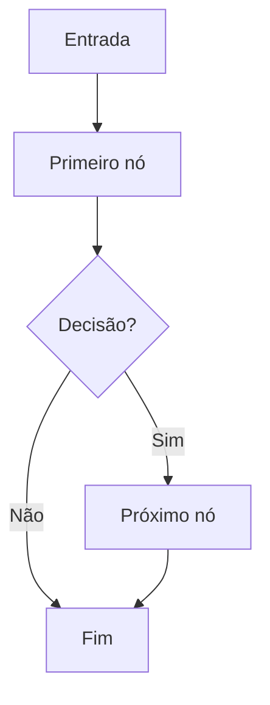

# LAB_TEMPLATE — SmartCommerce AI Lab

> Copiar este modelo para `labs/<module>/<lab>/README.md`. Idioma: português. Não marcar como concluído antes de executar e comprovar os critérios.

## 1. Identificação

- **Laboratório:** `<ID e nome>`
- **Status:** `PLANNED | IN_PROGRESS | VERIFIED | BLOCKED`
- **Competência:** `<conceito único que aprenderemos>`
- **Caso SmartCommerce:** `<case ID + pergunta do cliente>`
- **Por que usar IA?** `<baseline sem IA e justificativa>`

## 2. Problema e objetivo

Descreva a situação concreta, o comportamento desejado e o que **não** será coberto por este laboratório.

## 3. Grafo / arquitetura



Explicar nodes, edges, conditional edges, loops e limites. Se não usar LangGraph, explicar por quê.

## 4. Contratos, State, ferramentas e regras

| Campo / contrato | Tipo | Origem | Quem lê | Quem escreve |
|---|---|---|---|---|
| Exemplo | str | usuário | nó A | nó B |

Indicar quais decisões cabem ao LLM e quais exigem código determinístico.

## 5. Execução passo a passo

1. Entrada recebida.
2. State inicializado.
3. Nó executado e estado alterado.
4. Condição/roteamento avaliado.
5. Sucesso, reprocessamento ou saída por limite.

Inserir logs reais do console, com indicação de modo mock/live.

## 6. Como executar

```bash
# Comandos só devem aparecer após a implementação real.
# python lab.py run <lab-id> --mode mock --case <case-id>
# python lab.py run <lab-id> --mode live --case <case-id>
```

## 7. Testes e Evals

| Caso | Entrada | Resultado esperado | Evidência |
|---|---|---|---|
| Happy path | ... | ... | pytest/trace |
| Falha | ... | ... | pytest/trace |
| Limite | ... | ... | pytest/trace |
| Segurança | ... | ... | pytest/trace |

Métricas opcionais: acerto por tarefa, groundedness, sucesso de tool call, latência, tokens, custo. Nunca publicar métricas inventadas.

## 8. Debugging guiado

- Em quais funções colocar breakpoints?
- Qual é o State antes e depois de cada nó?
- Qual condição determina a próxima transição?
- O que acontece quando tool ou LLM falha?
- Como funciona o encerramento?

## 9. Trade-offs e alternativas

Compare solução atual versus baseline, técnica mais simples, outra arquitetura e limites reais da abordagem.

## 10. Exercícios para fazer sem IA

- [ ] Adicionar uma rota/campo/regra.
- [ ] Introduzir uma falha controlada e corrigir.
- [ ] Criar novo teste que demonstre uma limitação.

## 11. Checklist final

- [ ] Executado realmente; testes passaram.
- [ ] Resultados mock/live distinguidos.
- [ ] Segurança, limites e dados fictícios respeitados.
- [ ] Diagramas e documentação revisados.
- [ ] Consegui explicar e modificar sem ajuda da IA.
